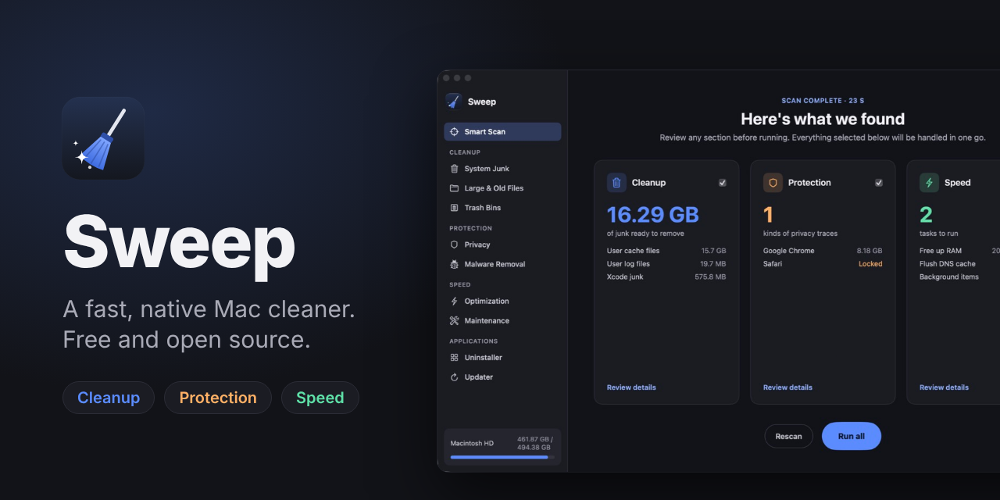
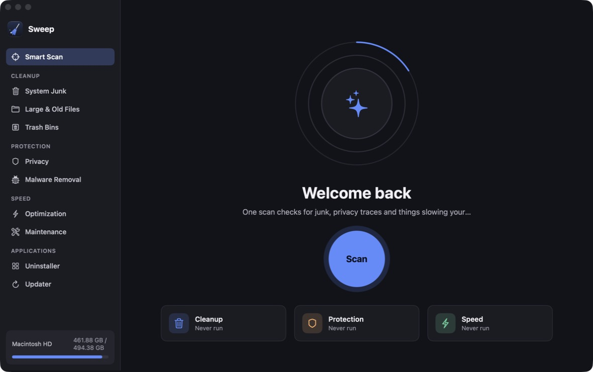
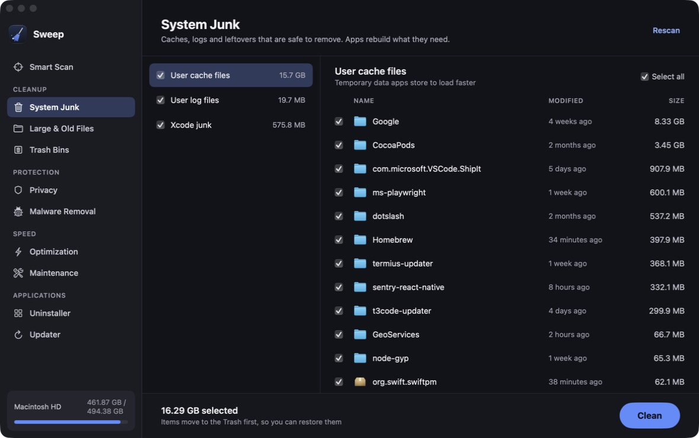
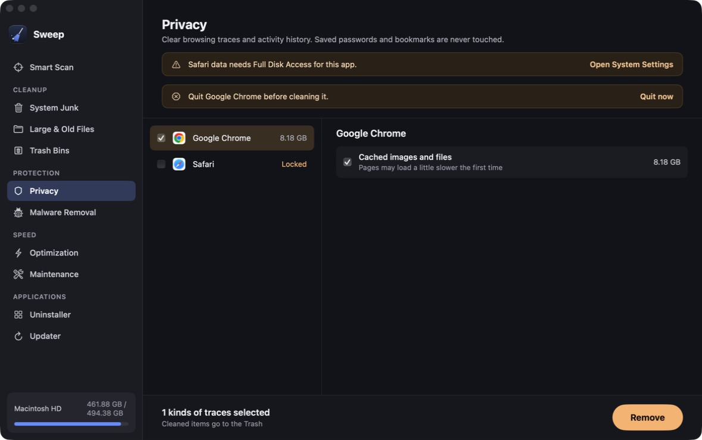
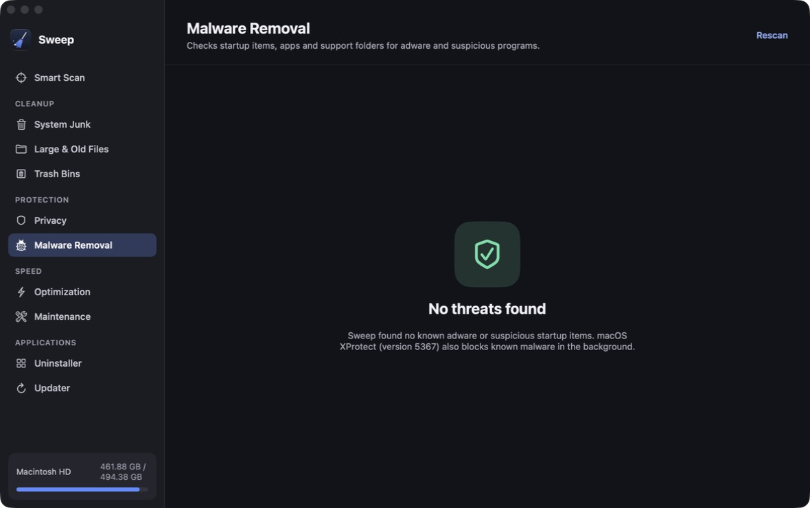
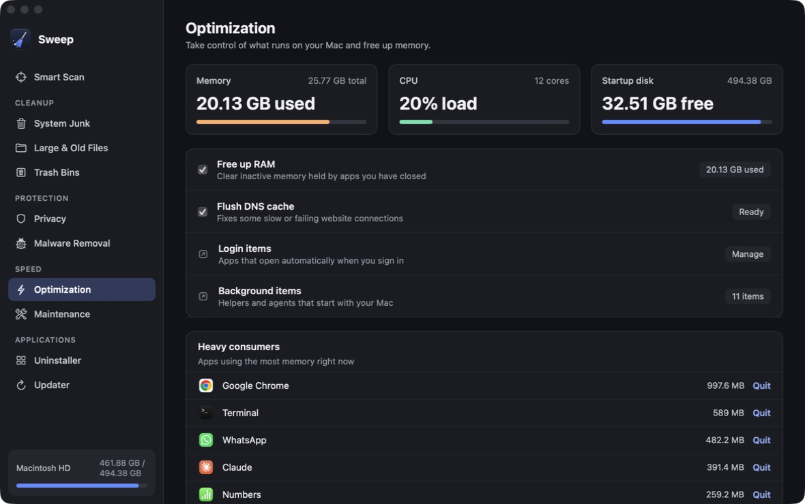
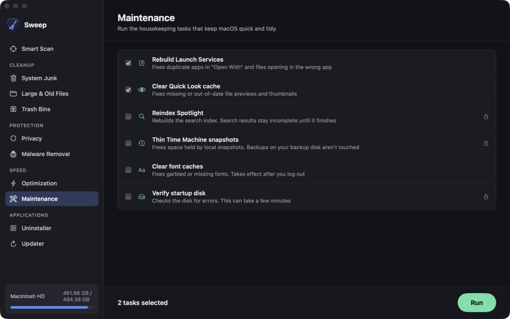
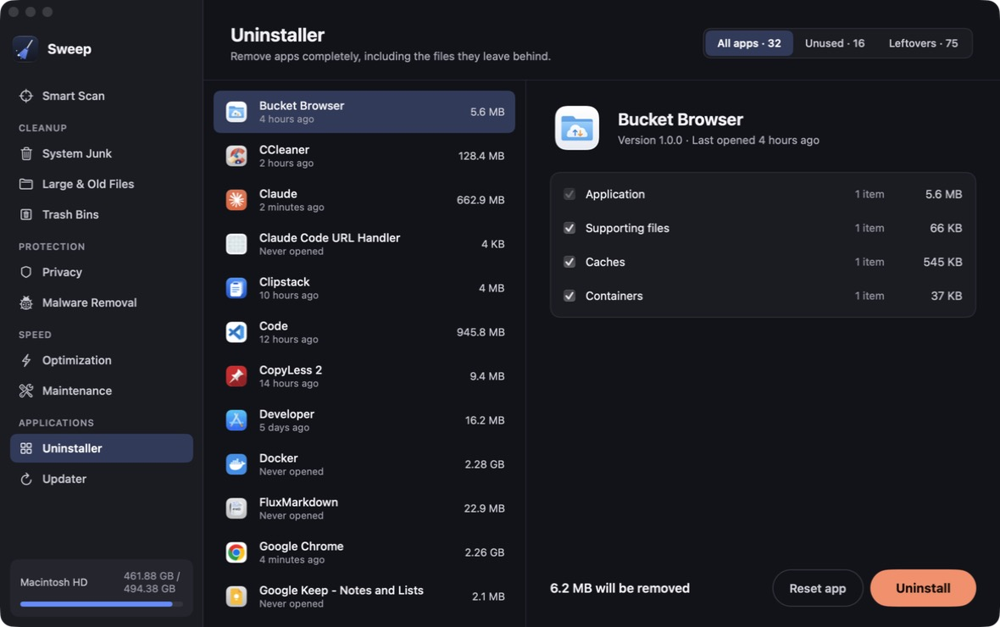
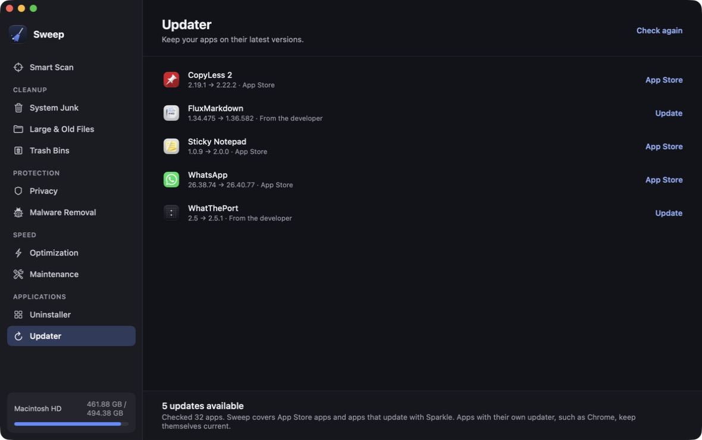

<p align="center">
  
</p>

<p align="center">
  <a href="https://github.com/chiranjeebhub/Sweep/releases/latest"></a>
  
  
  <a href="LICENSE"></a>
</p>

Sweep finds the caches, logs, browser traces, leftovers and stale apps that pile up on a Mac, shows you
exactly what it found, and cleans what you leave ticked. Everything it removes goes to the Trash first,
so nothing is gone until you say so.

## Features

Sweep has ten tools, grouped the same way they appear in the sidebar.

| | Screen | What it does |
| --- | --- | --- |
| ✨ | **Smart Scan** | Runs Cleanup, Protection and Speed together, shows one summary, and handles everything you leave ticked in one go. |
| **Cleanup** | **System Junk** | Finds user caches, user and system logs, and Xcode leftovers (DerivedData, device support, simulator caches). |
| | **Large & Old Files** | Lists files over 100 MB in Desktop, Documents, Downloads, Movies, Music and Pictures, filtered by size, age and kind. |
| | **Node Modules** | Finds every `node_modules` folder in your home folder with its size and how long since you last touched the project, so you can clear the ones you no longer need. |
| | **Trash Bins** | Shows how much space the Trash uses and empties it through Finder. |
| **Protection** | **Privacy** | Clears history, caches, sessions, cookies and form data for Chrome, Edge, Brave, Firefox and Safari, plus recent-items lists. Saved passwords and bookmarks are never touched. |
| | **Malware Removal** | Checks launch agents, launch daemons, apps and support folders for known Mac adware, startup items running from hidden or temporary folders, and unsigned programs that start on their own. Works alongside macOS XProtect. |
| **Speed** | **Optimization** | Live memory, CPU and disk figures. Frees inactive memory, flushes the DNS cache, lists the apps using the most memory, and links to Login Items. |
| | **Maintenance** | Runs maintenance scripts, rebuilds Launch Services, clears the Quick Look and font caches, reindexes Spotlight, thins Time Machine local snapshots and verifies the startup disk. |
| **Applications** | **Uninstaller** | Lists your apps with their real size and last-opened date, removes an app together with its support files, caches, preferences, containers and launch agents, and finds leftovers from apps already deleted. |
| | **Updater** | Checks App Store apps against the App Store and other apps against their Sparkle feed. Sparkle updates install in place after Sweep checks they're signed by the same developer. |

## Screenshots

<table>
  <tr>
    <td></td>
    <td></td>
  </tr>
  <tr>
    <td align="center"><b>Smart Scan</b></td>
    <td align="center"><b>System Junk</b></td>
  </tr>
  <tr>
    <td></td>
    <td></td>
  </tr>
  <tr>
    <td align="center"><b>Privacy</b></td>
    <td align="center"><b>Malware Removal</b></td>
  </tr>
  <tr>
    <td></td>
    <td></td>
  </tr>
  <tr>
    <td align="center"><b>Optimization</b></td>
    <td align="center"><b>Maintenance</b></td>
  </tr>
  <tr>
    <td></td>
    <td></td>
  </tr>
  <tr>
    <td align="center"><b>Uninstaller</b></td>
    <td align="center"><b>Updater</b></td>
  </tr>
</table>

## Install

1. Download the latest `Sweep-<version>.dmg` from [GitHub Releases](https://github.com/chiranjeebhub/Sweep/releases/latest).
2. Open the DMG and drag **Sweep** into **Applications**.
3. Open Sweep from Applications or Launchpad.

Releases are signed with a Developer ID and notarized by Apple, so Gatekeeper opens them without any
warnings. Each release also lists the DMG's SHA-256 checksum if you want to verify the download:

```sh
shasum -a 256 ~/Downloads/Sweep-*.dmg
```

Sweep needs macOS 13 Ventura or later and runs natively on Apple silicon and Intel Macs.

## Permissions

Sweep works without any special permissions, but macOS protects a few places that it can only reach with
**Full Disk Access**: Safari's history and caches, Messages attachments, and the contents of the Trash.
Without it, those items show as **Locked** and Sweep skips them.

To grant it:

1. Open **System Settings › Privacy & Security › Full Disk Access**.
2. Turn on **Sweep** (or click **+** and pick it from Applications).
3. Quit and reopen Sweep.

Sweep also uses the standard macOS administrator prompt for tasks that need it: freeing memory, flushing
DNS, some Maintenance tasks, and removing malware outside your home folder. It never stores your password.

## Safety

- Everything Sweep removes is **moved to the Trash**, never deleted outright, so you can put it back from
  Finder. Only **Empty Trash** is permanent, and it asks first.
- Browsers are skipped while they're open, because they rewrite their files when they quit.
- Saved passwords and bookmarks are never touched.
- Nothing is removed until you review the list and press the button. Scans are read-only.
- Sweep has no analytics and makes no network calls except the Updater's checks against the App Store and
  each app's own update feed.

## Build from source

You need macOS 13 or later and Xcode 15 or later (Swift 5.9).

```sh
git clone https://github.com/chiranjeebhub/Sweep.git
cd Sweep

# Run straight from the package
swift run Sweep

# Or build a double-clickable app into ./build/Sweep.app
scripts/build-app.sh
open build/Sweep.app
```

You can also open `Package.swift` in Xcode and run the **Sweep** scheme. Run the tests with `swift test`.

A locally built app is ad-hoc signed. If you move it to another Mac, macOS will ask you to confirm it the
first time you open it (right-click › Open).

### Releasing

`scripts/release.sh <version>` builds a universal app, signs it with a Developer ID, notarizes it, packs
it into a DMG and publishes it on GitHub Releases. See [docs/RELEASING.md](docs/RELEASING.md) for the
one-time certificate and notarization setup.

### Project layout

```
Sources/SweepCore/            Scanning and cleaning logic, no UI (unit tested)
Sources/Sweep/                SwiftUI app: models per screen, views, theme
Tests/                        Tests for SweepCore against temporary folders
Resources/Info.plist          App bundle metadata used by scripts/build-app.sh
Resources/AppIcon.svg         Source artwork for the app icon
Resources/AppIcon.icns        App icon built from AppIcon.svg
Resources/Sweep.entitlements  Hardened-runtime entitlements used when signing a release
scripts/build-app.sh          Builds build/Sweep.app
scripts/release.sh            Signed, notarized DMG release to GitHub (docs/RELEASING.md)
docs/                         Release guide, screenshots and README images
```

## Contributing

Bug reports and pull requests are welcome. Please open an issue first for larger changes, keep cleaning
logic in `SweepCore` with tests, and make sure `swift test` passes.

## More free Mac apps by me

| | |
| --- | --- |
| [Clipstack](https://github.com/chiranjeebhub/ClipStack) | Clipboard history for your Mac. ⇧⌘V, search, paste. |
| [NotchDeck](https://github.com/chiranjeebhub/NotchDeck) | Your MacBook notch as a hub for media, files, calendar and local dev servers. |
| [Shotwright](https://github.com/chiranjeebhub/Shotwright) | Screenshots, screen recordings and annotations for macOS. |

## License

Sweep is released under the [MIT License](LICENSE). © 2026 Chiranjeeb Jena.
